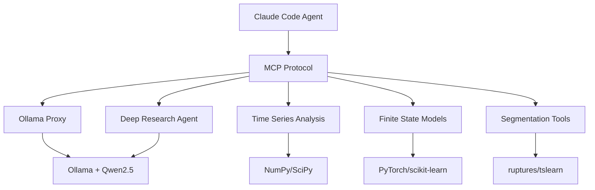

# qi-v2-ts Architecture Documentation

This directory contains the complete architectural documentation for the qi-v2-ts time series research framework.

## Documents

- **[System Overview](system-overview.md)** - High-level architecture and components
- **[MCP Integration](mcp-integration.md)** - Model Context Protocol server architecture
- **[Research Workflow](research-workflow.md)** - Research process and tool integration
- **[Data Flow](data-flow.md)** - Data processing and communication patterns
- **[Deployment](deployment.md)** - Setup and configuration guide

## Architecture Summary

qi-v2-ts is a research framework that combines:

- **Claude Code** - Agent interface and orchestration
- **Ollama + Qwen2.5** - Local LLM processing
- **SkyworkAI DeepResearchAgent** - Deep research capabilities
- **Specialized MCP Servers** - Time series analysis tools
- **Multi-Scale FSM** - Novel finite state modeling approach

## Quick Architecture Overview

All components run locally with no external API dependencies.