# Data Flow Architecture

## Data Flow Overview

qi-v2-ts implements a multi-layered data flow architecture that handles research information, time series data, model parameters, and results across different components.

## Data Flow Diagram

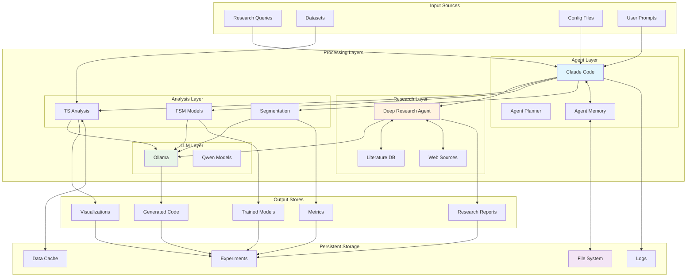

## Data Types and Formats

### 1. Research Data

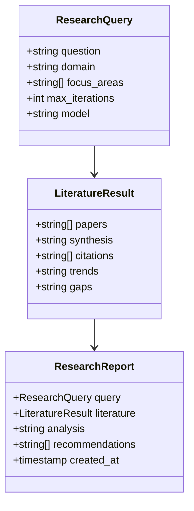

### 2. Time Series Data

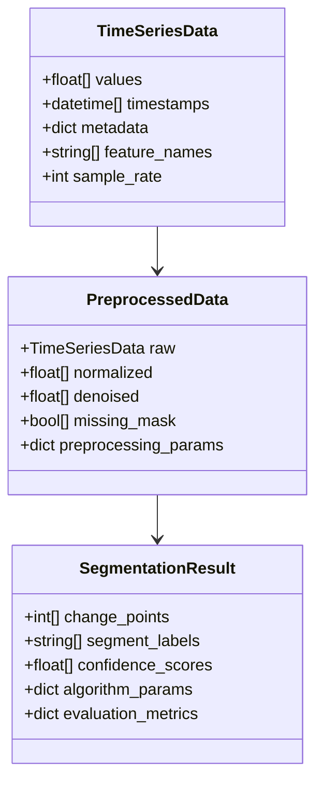

### 3. Model Data

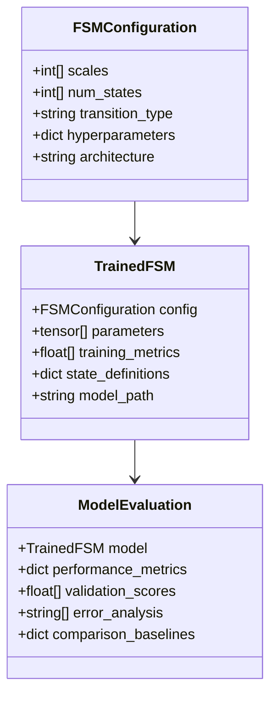

## Data Processing Pipeline

### 1. Research Data Pipeline

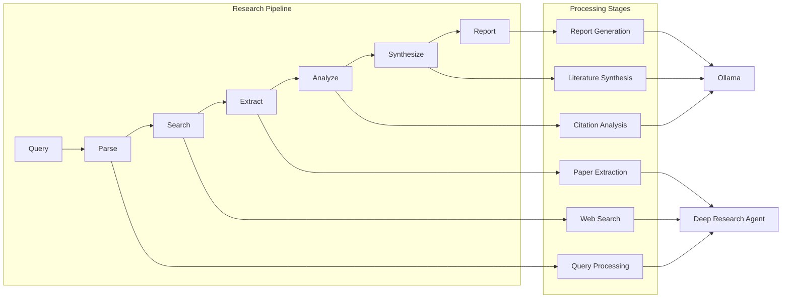

### 2. Time Series Processing Pipeline

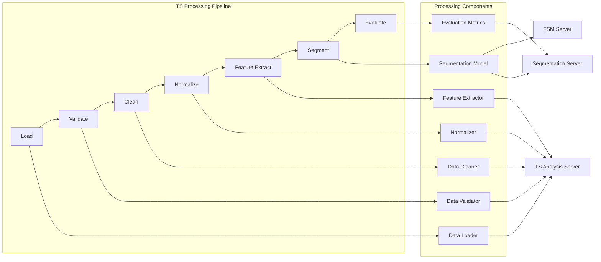

## Data Storage Architecture

### 1. File System Organization

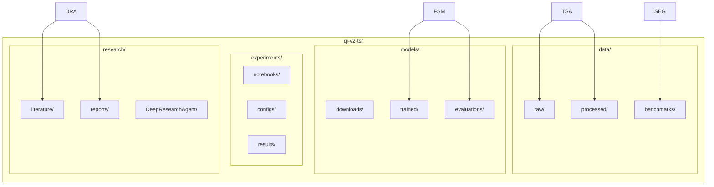

### 2. Data Flow Between Servers

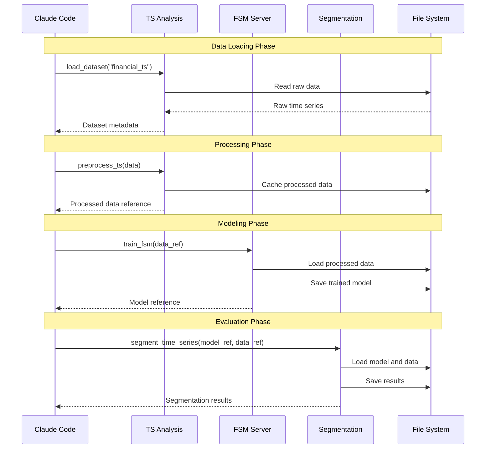

## Data Consistency and Integrity

### 1. Data Validation

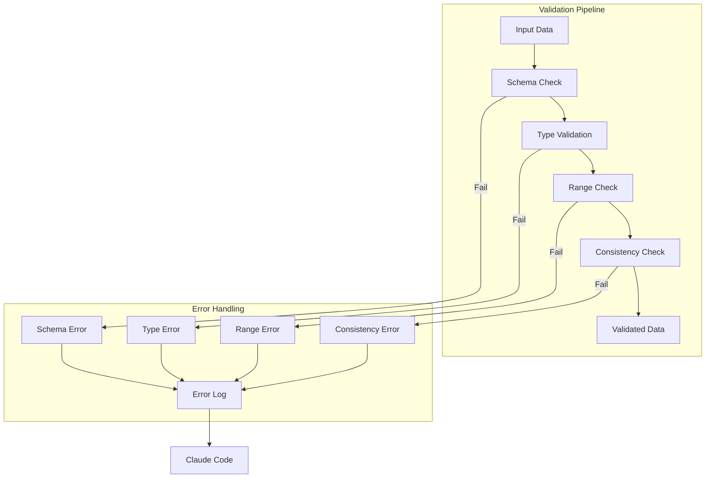

### 2. Data Versioning

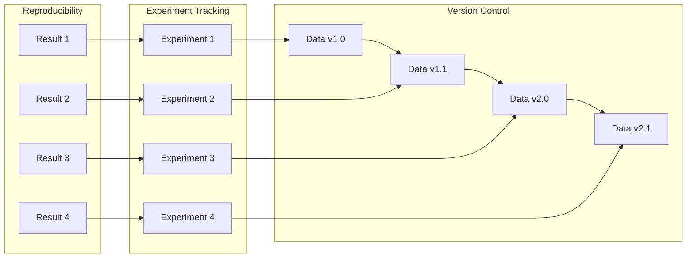

## Performance Optimization

### 1. Caching Strategy

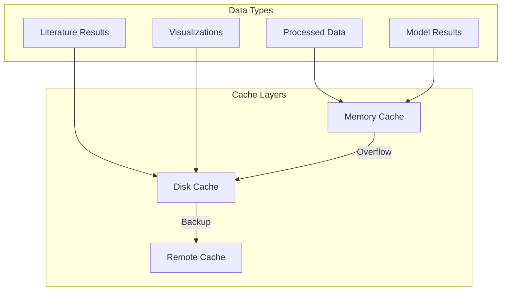

### 2. Data Streaming

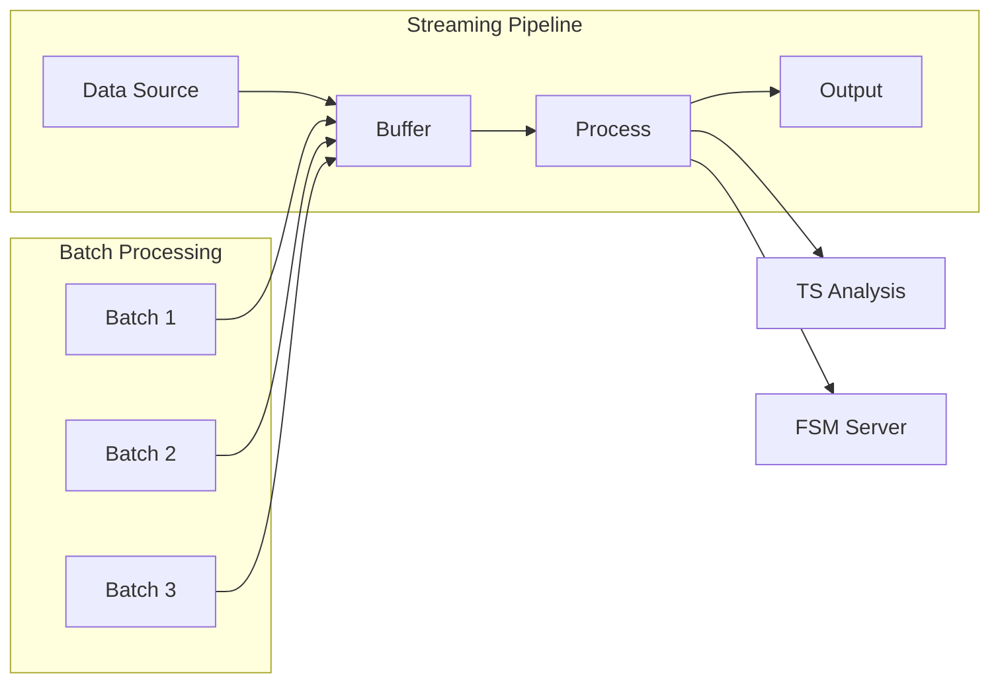

This architecture ensures efficient, reliable, and scalable data flow throughout the research process.