# Deployment Architecture

## Deployment Overview

qi-v2-ts is designed for local deployment with minimal external dependencies. All components run on a single machine with local LLM processing.

## Deployment Topology

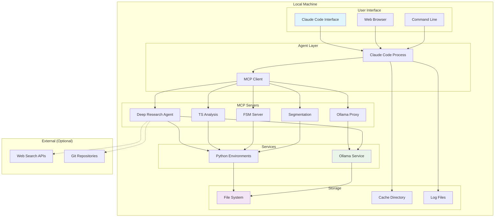

## System Requirements

### Hardware Requirements

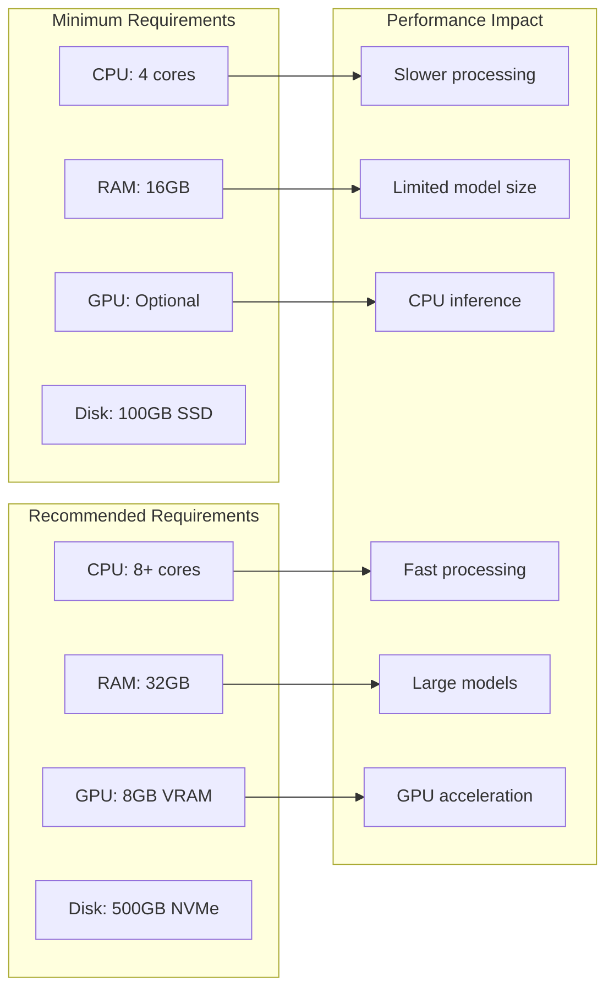

### Software Dependencies

```mermaid
graph TB
    subgraph "Base System"
        OS[Linux/macOS/Windows]
        SHELL[Bash/Zsh]
        GIT_S[Git]
    end

    subgraph "Runtime Environments"
        PY[Python 3.11+]
        NODE[Node.js 18+]
        OLLAMA[Ollama]
    end

    subgraph "Package Managers"
        PIP[pip]
        PYENV[pyenv (optional)]
        NPM[npm]
    end

    subgraph "Claude Code"
        CC_APP[Claude Code Application]
        MCP_SDK[MCP SDK]
    end

    OS --> PY
    OS --> NODE
    OS --> OLLAMA
    PY --> PIP
    PY --> PYENV
    NODE --> NPM
    CC_APP --> MCP_SDK
```

## Installation Process

### 1. Automated Setup

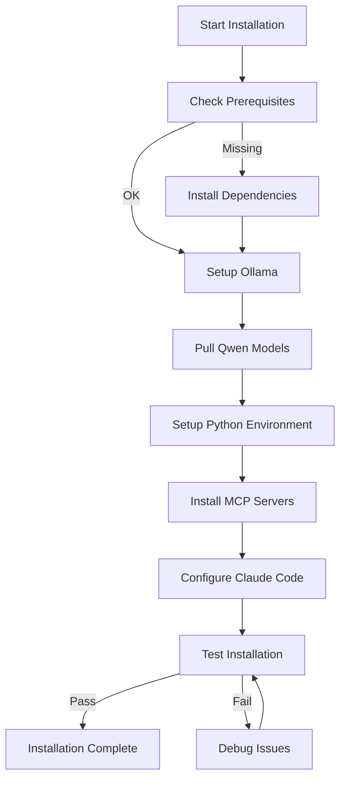

### 2. Setup Scripts

```bash
#!/bin/bash
# setup.sh - Main setup script

echo "🚀 Setting up qi-v2-ts research framework..."

# Check prerequisites
./scripts/check-prerequisites.sh

# Setup Ollama and models
./setup-ollama.sh

# Setup Python environments
./scripts/setup-python.sh

# Configure Claude Code
./scripts/configure-claude-code.sh

# Run tests
./scripts/test-installation.sh

echo "✅ qi-v2-ts setup complete!"
```

## Configuration Management

### 1. Configuration Structure

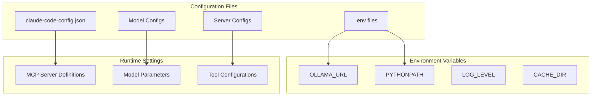

### 2. Configuration Templates

```json
{
  "claude-code-config.json": {
    "mcpServers": {
      "ollama-proxy": {
        "command": "python",
        "args": ["servers/ollama-proxy/src/ollama_proxy/mcp_server.py"],
        "env": {
          "OLLAMA_URL": "http://localhost:11434"
        }
      }
    }
  }
}
```

## Service Management

### 1. Service Architecture

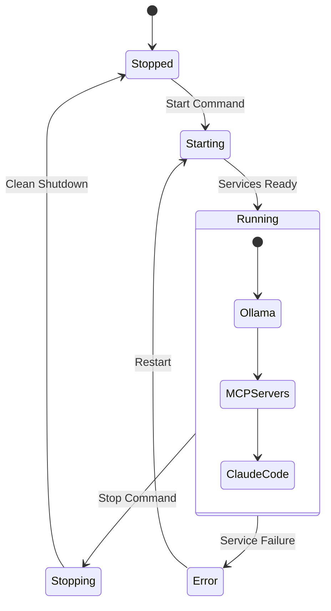

### 2. Process Management

```bash
# Service management scripts

# Start all services
./scripts/start-services.sh

# Stop all services
./scripts/stop-services.sh

# Restart services
./scripts/restart-services.sh

# Check service status
./scripts/check-services.sh
```

## Monitoring and Logging

### 1. Logging Architecture

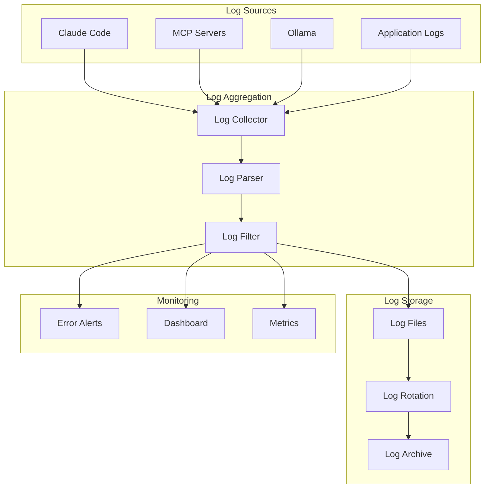

### 2. Health Checks

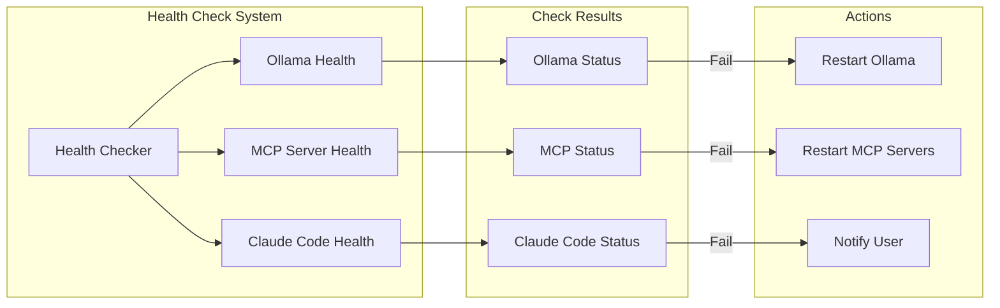

## Backup and Recovery

### 1. Backup Strategy

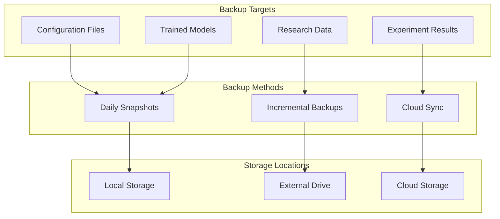

### 2. Disaster Recovery

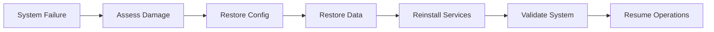

## Scaling Considerations

### 1. Horizontal Scaling

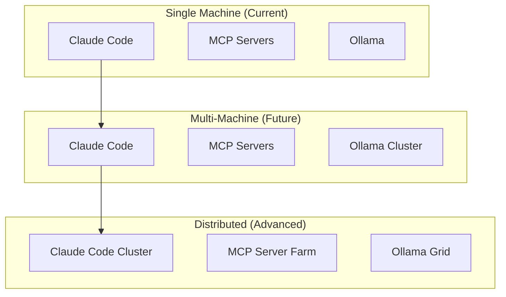

### 2. Performance Tuning

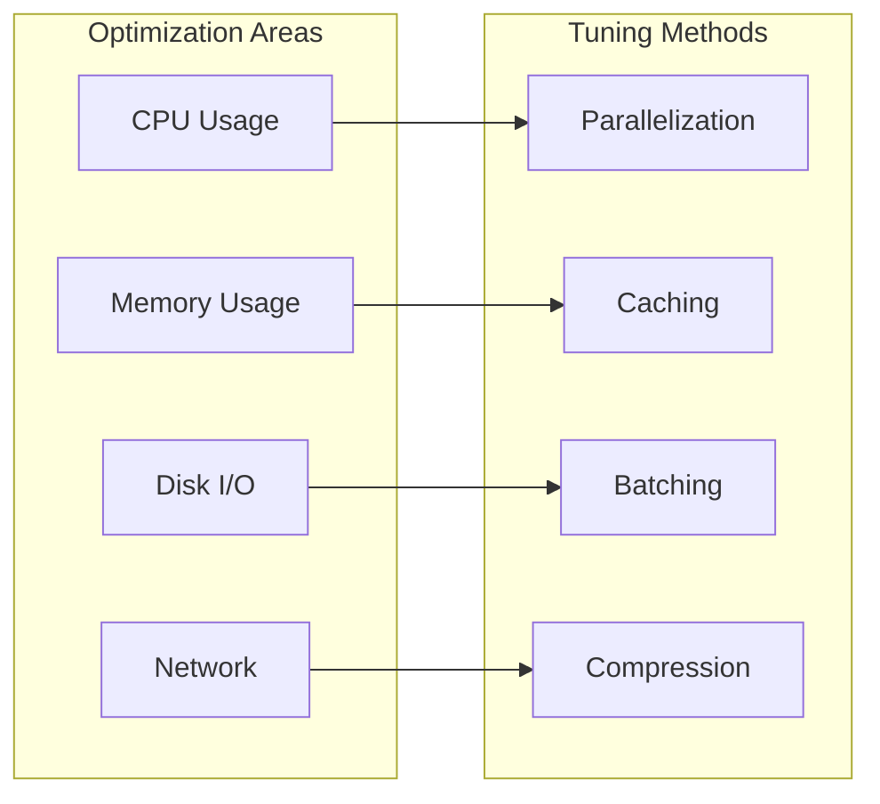

This deployment architecture ensures a robust, maintainable, and scalable research environment.