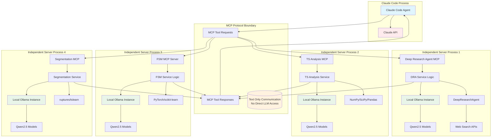
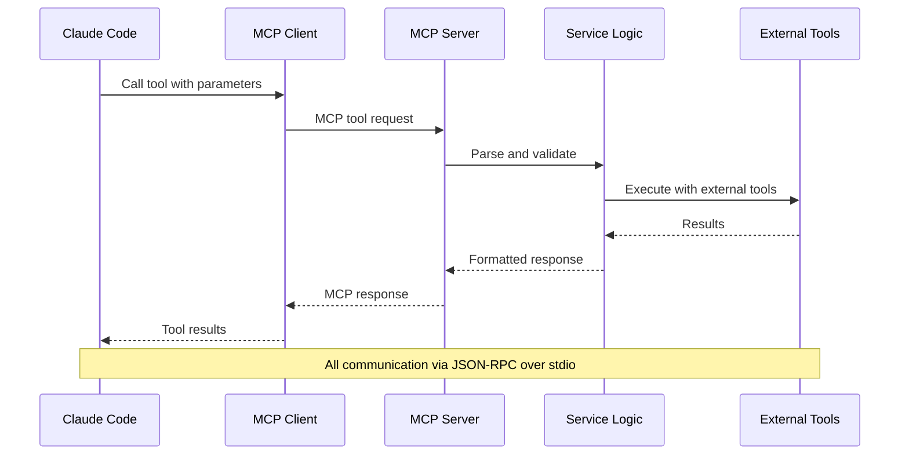
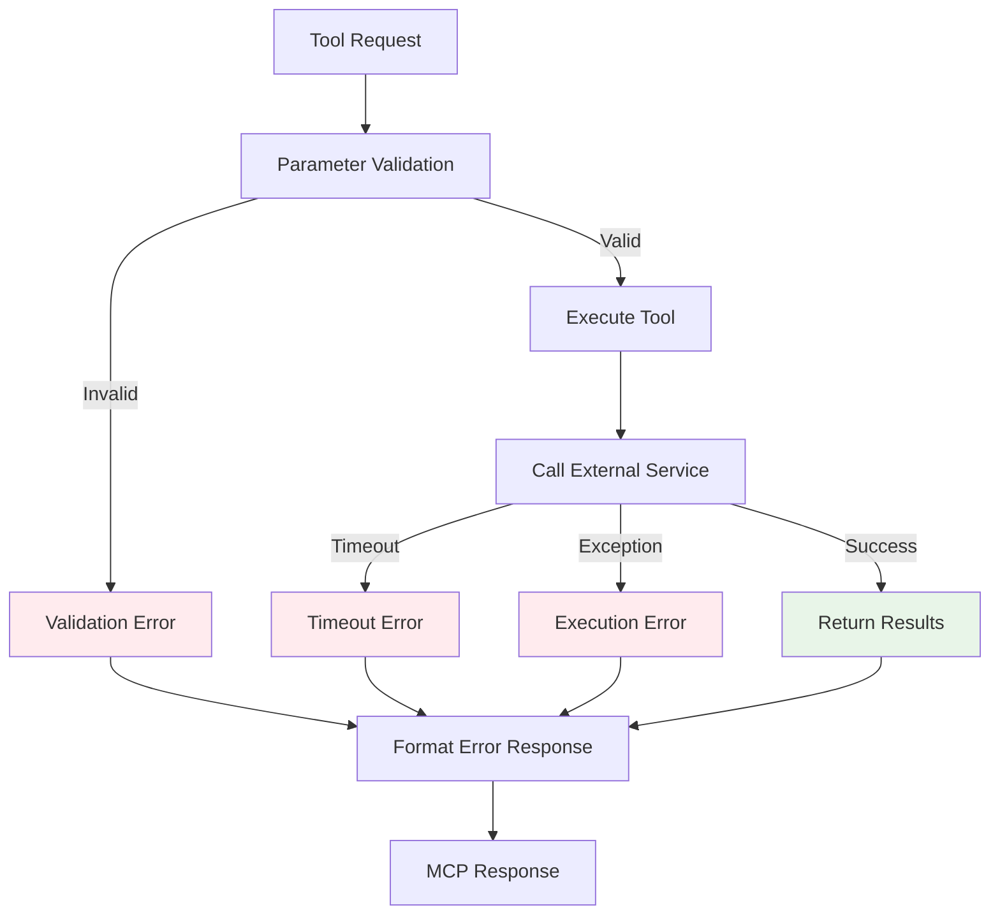
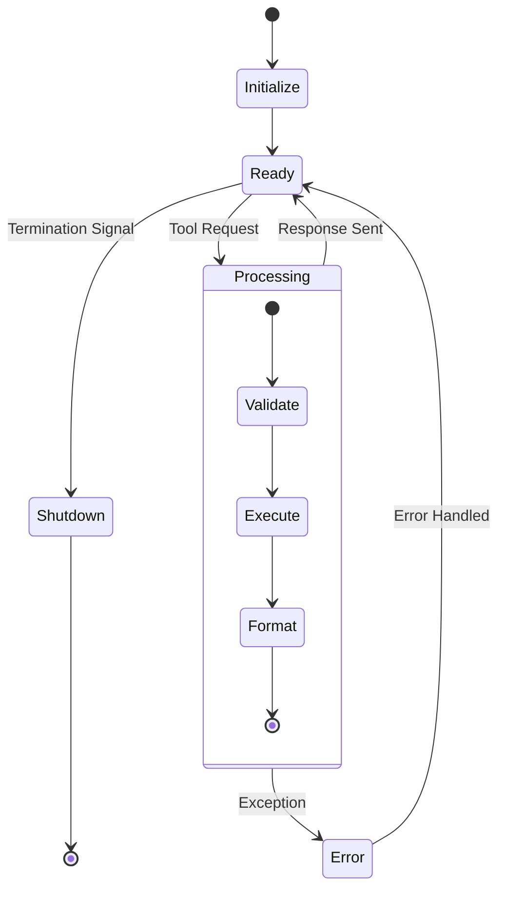

# MCP Integration Architecture

## Model Context Protocol (MCP) Overview

MCP provides a standardized way for Claude Code to integrate with specialized tools and services. **Critically**: Claude Code only sends tool requests and receives text responses - it does NOT directly access or control the local LLMs within MCP servers.

In qi-v2-ts, each MCP server is a completely independent process that:
- Runs its own local Ollama connection
- Performs heavy research/computation internally
- Returns processed results as text to Claude Code
- Operates with full privacy (no data sharing with Claude Code)

## MCP Server Architecture



## Server Configurations

### 1. Deep Research Agent Server

```json
{
  "name": "deep-research-agent",
  "command": "python",
  "args": ["servers/deep-research-agent/src/deep_research_agent/mcp_server.py"],
  "env": {
    "DEEP_RESEARCH_AGENT_PATH": "/home/zzhang/dev/qi/github/qi-v2-ts/research/DeepResearchAgent",
    "OLLAMA_URL": "http://localhost:11434"
  }
}
```

**Key Features:**
- **Independent Process**: Runs completely separately from Claude Code
- **Local LLM**: Has its own dedicated Ollama connection
- **Privacy**: Research data never shared with Claude Code
- **Tools Provided:**
  - `deep_research` - General research queries
  - `time_series_literature_review` - Specialized TS literature reviews
  - `research_finite_state_models` - FSM-specific research

### 2. Time Series Analysis Server

```json
{
  "name": "ts-analysis",
  "command": "python",
  "args": ["servers/ts-analysis/src/mcp_server.py"],
  "env": {
    "OLLAMA_URL": "http://localhost:11434"
  }
}
```

**Key Features:**
- **Independent Process**: Own Python environment and Ollama connection
- **Local Processing**: All time series data stays local
- **Tools Provided:**
  - `load_dataset` - Load time series datasets
  - `preprocess_ts` - Data preprocessing with local LLM assistance
  - `visualize_ts` - Time series visualization
  - `statistical_analysis` - Statistical measures and analysis

### 3. Finite State Models Server

```json
{
  "name": "finite-state-models",
  "command": "python",
  "args": ["servers/finite-state-models/src/mcp_server.py"],
  "env": {
    "OLLAMA_URL": "http://localhost:11434"
  }
}
```

**Key Features:**
- **Independent Process**: Dedicated to FSM research and implementation
- **Local LLM Integration**: Uses Qwen2.5 for code generation and optimization
- **Tools Provided:**
  - `create_multi_scale_fsm` - Create FSM architecture with local LLM assistance
  - `train_fsm` - Model training with intelligent hyperparameter tuning
  - `analyze_fsm_performance` - Performance analysis and visualization
  - `state_inference` - State sequence inference and interpretation

### 4. Segmentation Server

```json
{
  "name": "segmentation",
  "command": "python",
  "args": ["servers/segmentation/src/mcp_server.py"],
  "env": {
    "OLLAMA_URL": "http://localhost:11434"
  }
}
```

**Key Features:**
- **Independent Process**: Specialized for time series segmentation
- **Algorithm Intelligence**: Local LLM assists with algorithm selection and tuning
- **Tools Provided:**
  - `change_point_detection` - Intelligent change point detection
  - `segment_time_series` - Multi-algorithm segmentation with optimization
  - `evaluate_segmentation` - Comprehensive performance evaluation
  - `optimize_boundaries` - LLM-assisted boundary refinement

## Communication Flow



## Error Handling



## Server Lifecycle



## Benefits of MCP Architecture

1. **Standardization**: Consistent tool interface across all servers
2. **Isolation**: Each server runs in its own process
3. **Reliability**: Server failures don't crash the main agent
4. **Scalability**: Easy to add new research domains
5. **Type Safety**: JSON schema validation for all tool calls
6. **Debugging**: Clear separation of concerns for troubleshooting