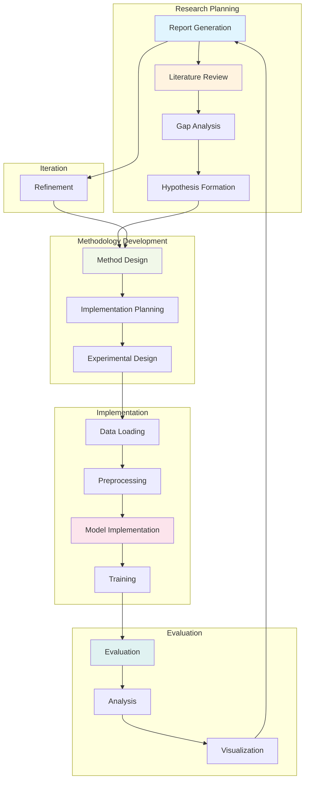
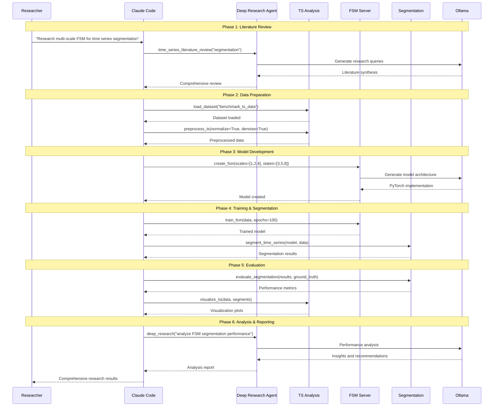
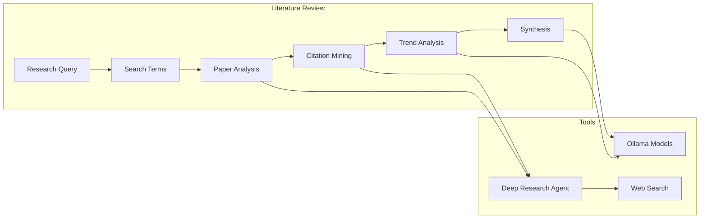
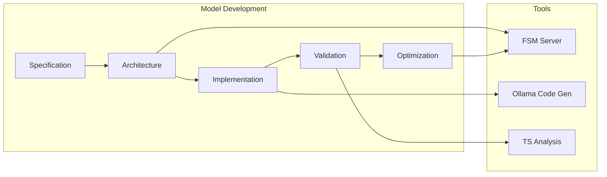
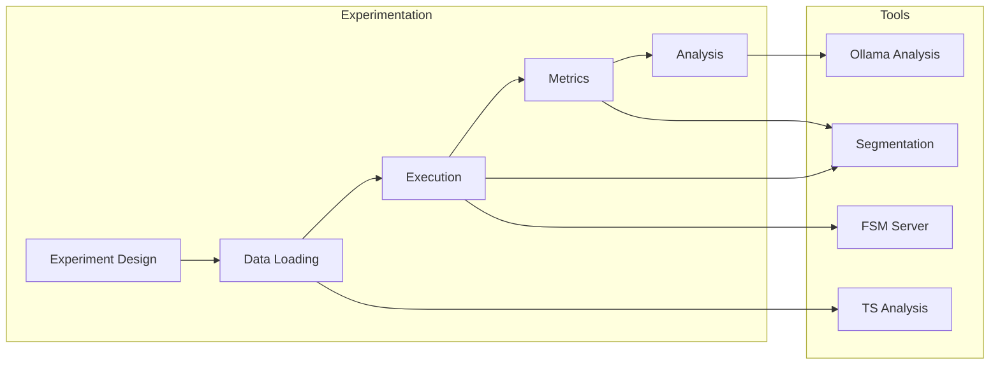
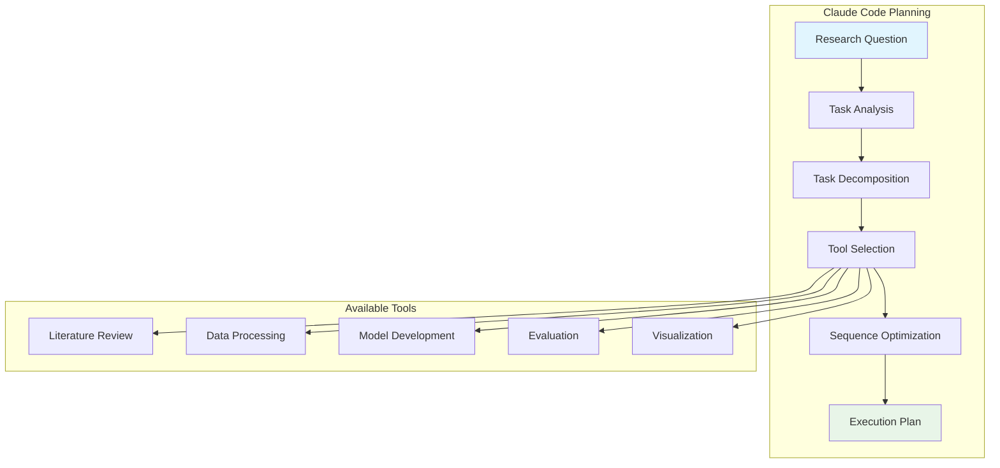
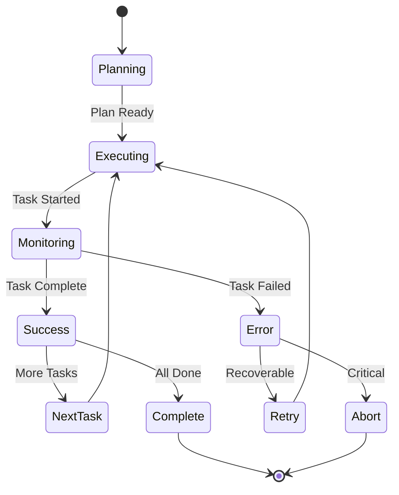

# Research Workflow Architecture

## Research Process Overview

qi-v2-ts implements a structured research workflow that combines literature review, methodology development, experimentation, and analysis.

## Workflow Stages



## Tool Integration Workflow



## Research Task Types

### 1. Literature Review Tasks



### 2. Model Development Tasks



### 3. Experimental Tasks



## Workflow Orchestration

### Agent Planning



### Execution Monitoring



## Research Patterns

### 1. Comparative Study Pattern

```python
# Example workflow for comparing segmentation methods
async def comparative_study():
    # Literature review
    literature = await deep_research("time series segmentation methods comparison")

    # Data preparation
    datasets = await load_benchmark_datasets()

    # Method implementation
    methods = [
        await implement_fsm_segmentation(),
        await implement_hmm_segmentation(),
        await implement_cpt_segmentation()
    ]

    # Evaluation
    results = []
    for method in methods:
        result = await evaluate_method(method, datasets)
        results.append(result)

    # Analysis
    analysis = await compare_results(results)
    report = await generate_report(analysis)

    return report
```

### 2. Novel Method Development Pattern

```python
# Example workflow for developing new FSM approach
async def novel_method_development():
    # Gap analysis
    gaps = await analyze_literature_gaps("multi-scale FSM")

    # Method design
    design = await design_novel_approach(gaps)

    # Implementation
    model = await implement_multi_scale_fsm(design)

    # Validation
    validation = await validate_method(model)

    # Refinement
    refined_model = await refine_method(model, validation)

    return refined_model
```

## Integration Benefits

1. **Systematic Approach**: Structured research process
2. **Tool Synergy**: Tools work together seamlessly
3. **Reproducibility**: Documented workflow steps
4. **Efficiency**: Automated routine tasks
5. **Quality**: Built-in validation and verification
6. **Traceability**: Complete research audit trail