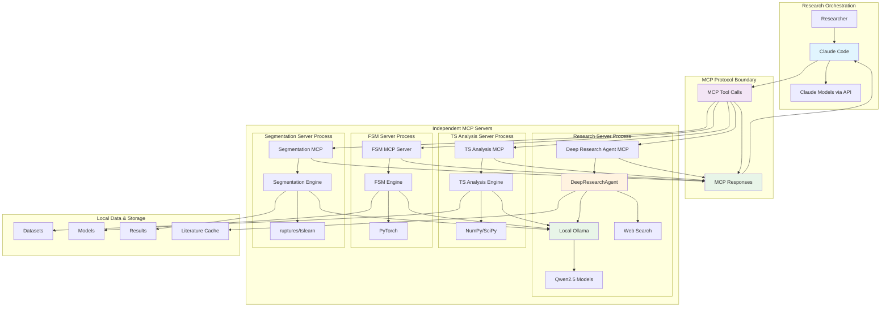
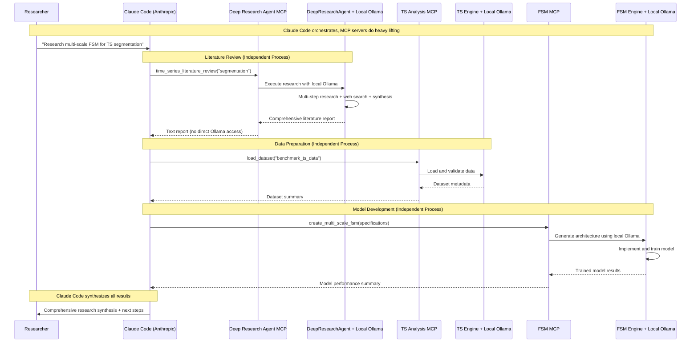

# System Overview

## Architecture Philosophy

qi-v2-ts implements a **local-first, agent-driven research framework** that combines the power of modern AI agents with specialized domain tools for time series research.

## Core Principles

1. **Local Execution** - All processing happens locally (no API costs, full privacy)
2. **Agent-Driven** - Claude Code orchestrates complex research workflows
3. **Modular Design** - Specialized MCP servers for different research domains
4. **Research-Focused** - Purpose-built for time series segmentation research

## High-Level Architecture

## Component Responsibilities

### Claude Code Agent (Anthropic Models)
- **Role**: Master orchestrator and workflow coordinator
- **LLM**: Uses Anthropic's Claude models via API
- **Capabilities**:
  - High-level task planning and decomposition
  - MCP tool coordination and sequencing
  - Result synthesis and report generation
  - User interaction and decision making
- **Limitation**: Does NOT process research content directly - delegates to MCP servers

### MCP Protocol Layer
- **Role**: Clean separation between orchestration and processing
- **Function**: Standardized tool interface for Claude Code
- **Communication**: JSON-RPC over stdio (text in/text out)
- **Benefits**:
  - Complete process isolation
  - Independent server lifecycle management
  - Type-safe tool definitions

### Independent MCP Servers (Local Processing)
- **Role**: Heavy computational and research work
- **LLM**: Each server has its own local Ollama + Qwen2.5 connection
- **Architecture**: Completely independent Python processes
- **Models Available**:
  - `qwen2.5:7b` - General research and analysis
  - `qwen2.5:14b` - Complex reasoning and synthesis
- **Benefits**:
  - No API costs for research processing
  - Full privacy (data never leaves local machine)
  - Offline operation capability
  - Specialized domain expertise per server

### Deep Research Agent
- **Role**: Comprehensive literature research
- **Capabilities**:
  - Multi-step research planning
  - Web search and citation analysis
  - Academic paper synthesis
  - Trend identification

### Specialized MCP Servers
- **Time Series Analysis**: Data loading, preprocessing, visualization
- **Finite State Models**: Multi-scale FSM implementation and training
- **Segmentation**: Change point detection and boundary optimization

## Research Workflow Integration

## Key Benefits

1. **Hybrid Cost Model**:
   - Claude Code API costs only for orchestration
   - Unlimited local research processing with Ollama (zero cost)
   - Research-heavy workloads run locally

2. **Privacy & Security**:
   - Research data never leaves local machine
   - Sensitive time series data processed locally
   - Only high-level orchestration goes through API

3. **Best of Both Worlds**:
   - Claude Code's superior planning and orchestration
   - Local LLM power for compute-intensive research tasks
   - Clean separation of concerns

4. **Scalability**:
   - MCP servers can be upgraded independently
   - Add new research domains without changing Claude Code
   - Local processing scales with hardware

5. **Reproducibility**:
   - Deterministic local LLM environment
   - Version-controlled MCP server implementations
   - Consistent research methodology

6. **Domain Specialization**:
   - Each MCP server optimized for specific research tasks
   - Custom prompts and workflows per domain
   - Specialized model fine-tuning capability